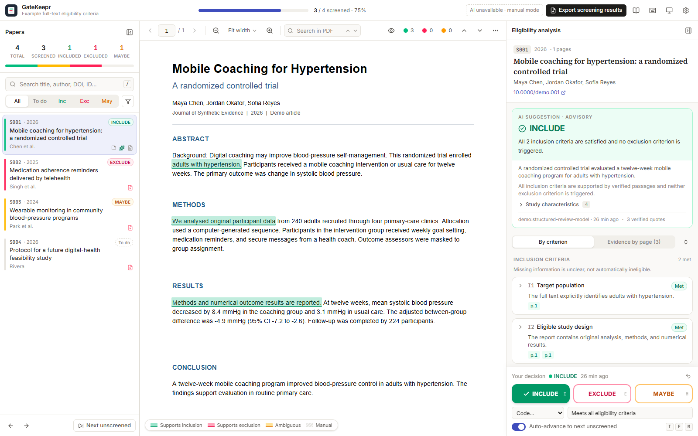
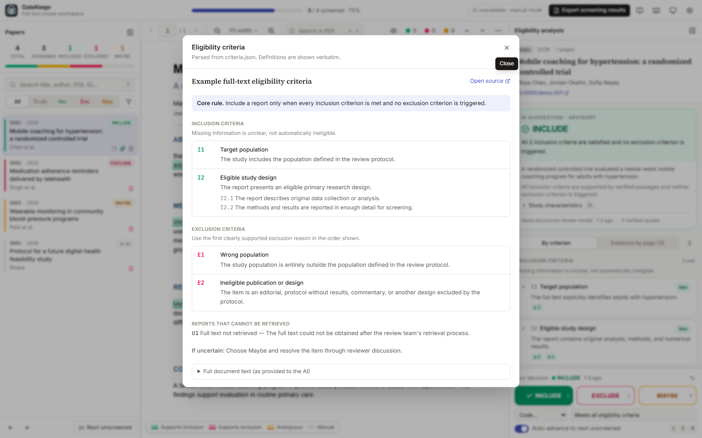
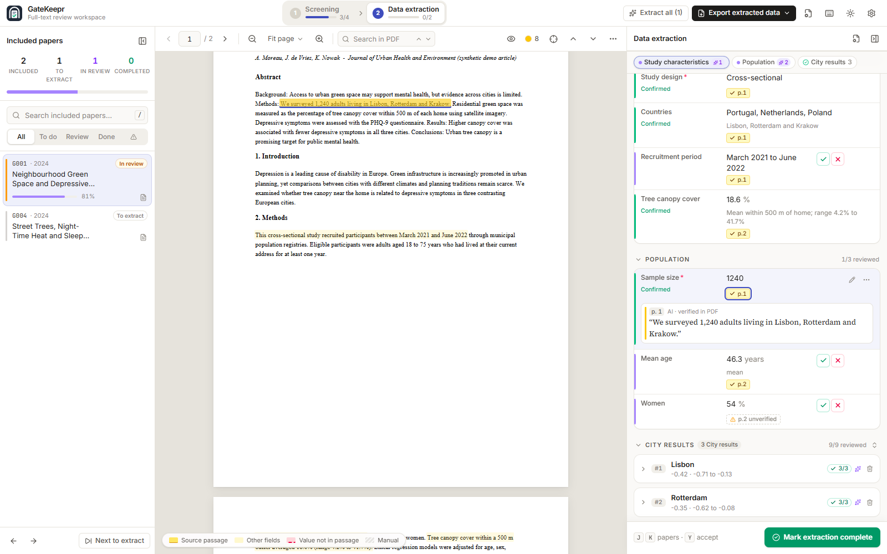
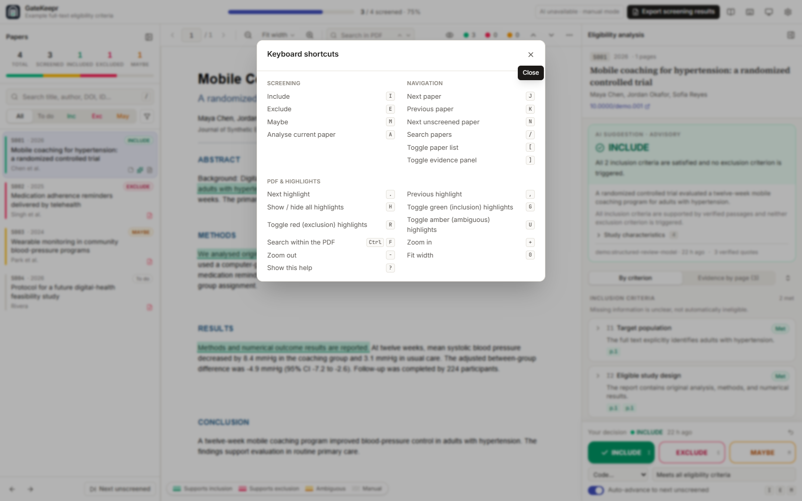

<p align="center">
  
</p>

# GateKeepr

**GateKeepr** is a local-first web application for evidence-based full-text screening and data extraction in literature reviews. Reviewers can read PDFs, annotate passages, assess configurable inclusion and exclusion criteria, record decisions, extract structured data from included papers with every value linked to its source passage, and optionally request advisory AI assistance.

The application is review-agnostic. Your criteria, paper list, PDFs, API credentials, and screening database are local inputs and are intentionally excluded from Git.

## Features

- PDF reader with search, zoom (opens at *Fit page*), keyboard navigation, and persistent evidence highlights
- Configurable inclusion and exclusion criteria
- Manual Include, Exclude, and Maybe decisions with notes and decision history
- Optional Gemini or OpenAI analysis with structured outputs
- Verification of every AI quotation against the extracted PDF text
- Data extraction for included papers with user-defined templates (single and repeatable groups, typed fields, linked records)
- Every extracted value linked to highlighted source passages in the PDF; unverifiable evidence is flagged, never hidden
- Researcher control: AI values stay suggestions until accepted, edited or rejected, and re-runs never overwrite reviewed work
- Relational CSV (ZIP) and JSON export of extracted data, plus provenance
- CSV export and JSON backup/restore
- Local SQLite storage; no hosted service is required

AI is optional. Reading, annotation, decisions, notes, backup, and export continue to work without an AI provider.

## Screenshots

These screenshots use synthetic demo data; no private review records or licensed article PDFs are included.

### Screen papers with evidence beside the full text

The three-pane workspace keeps the paper queue, searchable PDF, verified evidence highlights, criterion assessments, and the final human decision in one view. AI recommendations remain advisory.



### Bring your own eligibility criteria

Criteria are loaded from the review's `criteria.json` file and shown verbatim in the app, including protocol rules, definitions, sub-requirements, and unretrieved-report guidance.



### Extract data with every value linked to its source

Included papers move on to data extraction. Values extracted with your template are listed beside the PDF; clicking one jumps to its highlighted source passage, and AI suggestions stay pending until you accept, edit or reject them.



### Work quickly with keyboard shortcuts

Shortcuts cover screening decisions, paper navigation, PDF search and zoom, panel controls, evidence-highlight navigation, and accepting extracted values (`Y`).



## Quick start

Requirements: Python 3.10 or newer. The setup script can install a bundled Node.js runtime when a system installation is unavailable.

Windows PowerShell:

```powershell
git clone https://github.com/faraz-riaz/gatekeepr.git
cd gatekeepr
Copy-Item .env.example .env
.\app\start.bat
```

macOS or Linux:

```bash
git clone https://github.com/faraz-riaz/gatekeepr.git
cd gatekeepr
cp .env.example .env
chmod +x app/start.sh
./app/start.sh
```

The first run creates the virtual environment, installs dependencies, builds the frontend, creates starter input files when they are absent, and opens <http://127.0.0.1:8765>.

## Configure a review

The default local inputs are:

```text
criteria.json                 eligibility criteria
papers.csv                    canonical paper list and display order
pdfs/<Paper_ID>.pdf           full-text files
data/papers_manifest.json     optional acquisition metadata
app/storage/screening.db      generated reviewer data
```

Starter templates are in [`examples/`](examples). The startup scripts copy the criteria and paper templates to the repository root only when those files do not already exist.

### 1. Define eligibility criteria

Copy [`examples/criteria.example.json`](examples/criteria.example.json) to `criteria.json`, then replace the example content with the protocol-approved criteria for your review.

The JSON format is versioned and is the recommended input method:

```json
{
  "schema_version": 1,
  "title": "My review",
  "core_rule": "Include only when all inclusion criteria are met and no exclusion applies.",
  "inclusion": [
    {
      "id": "I1",
      "name": "Target population",
      "definition": "The study includes ...",
      "exclusion_code": "E1"
    }
  ],
  "exclusion": [
    {
      "id": "E1",
      "name": "Wrong population",
      "definition": "The study population is entirely ...",
      "paired_inclusion": "I1"
    }
  ]
}
```

Criterion IDs only need to be unique; `I1` and `E1` are conventions, not hard-coded requirements. Useful optional fields are:

- `inclusion_rule`, `exclusion_rule`, `do_not_exclude`, `if_uncertain`, and `guidance` for protocol instructions supplied to the model.
- `allow_not_applicable: true` when an inclusion criterion can legitimately be inapplicable.
- `exclusion_code` on an inclusion criterion to define the exclusion code used when that inclusion is clearly not met.
- `paired_inclusion` on an exclusion criterion so positive inclusion evidence can support a “confirmed absent” exclusion assessment.
- `advisory: true` on exclusions that should lead to reviewer discussion instead of automatic exclusion.
- `sub_requirements` with `kind: "all_required"` when every part must be met, or `kind: "route"` when any alternative route can satisfy the parent criterion.
- `unretrieved` codes for decisions made when no full text is available.

The application reloads criteria when the source file changes and marks earlier analyses as potentially outdated.

#### Legacy criteria PDFs

PDF criteria sources remain supported for compatibility. Set, for example:

```env
SCREENING_CRITERIA_FILE=my_criteria.pdf
```

The PDF parser is intentionally limited: it expects tables headed `Code`, with code, name, and definition columns, and inclusion/exclusion codes prefixed by `I` and `E`. JSON is more reliable for new reviews because PDF layouts vary substantially.

### 2. Add the paper list

Create `papers.csv`. Only a unique paper ID is required; common metadata columns are detected case-insensitively.

```csv
Paper_ID,Paper_Title,Authors,Year,DOI,Link
P001,Example title,"Author, A.; Author, B.",2025,10.0000/example,https://example.org/article
```

Accepted ID column names are `Paper_ID`, `paper_id`, or `id`. Recommended columns are title, authors, year, DOI, and link.

Put full texts in `pdfs/` and name each file exactly `<Paper_ID>.pdf`, such as `pdfs/P001.pdf`. Then choose **Settings → Re-sync sources**. PDF files do not need to be committed and usually should not be redistributed without checking their licences.

### 3. Optional manifest

The app works without a manifest. Use `data/papers_manifest.json` only when you need a custom PDF path or acquisition metadata such as PMID, PMCID, access status, licence, checksum, duplicate relationships, or landing-page URLs. See [`examples/papers_manifest.example.json`](examples/papers_manifest.example.json).

### 4. Environment settings

Copy `.env.example` to `.env`. Important path overrides are:

| Variable | Default | Purpose |
|---|---|---|
| `SCREENING_CRITERIA_FILE` | `criteria.json` | JSON or compatible PDF criteria source |
| `SCREENING_PAPERS_CSV` | `papers.csv` | Paper list |
| `SCREENING_MANIFEST` | `data/papers_manifest.json` | Optional manifest |
| `SCREENING_PDF_DIR` | `pdfs` | Local PDF directory |
| `SCREENING_STORAGE_DIR` | `app/storage` | Runtime database directory |
| `SCREENING_PORT` | `8765` | Local HTTP port |

Relative paths resolve from `SCREENING_ROOT`, which defaults to the repository root. Use a separate storage directory or clone for each review to prevent paper IDs and reviewer data from different projects from sharing one database.

## Optional AI setup

Set `SCREENING_AI_PROVIDER` to `gemini`, `openai`, `auto`, or `none`.

For the Gemini Developer API:

```env
SCREENING_AI_PROVIDER=gemini
GEMINI_API_KEY=your-key
GEMINI_MODEL=gemini-3.8-flash
```

For Vertex AI:

```env
SCREENING_AI_PROVIDER=gemini
GOOGLE_GENAI_USE_VERTEXAI=true
GOOGLE_CLOUD_PROJECT=your-project-id
GOOGLE_CLOUD_LOCATION=global
GEMINI_MODEL=gemini-3.8-flash
```

Authenticate Application Default Credentials before starting:

```bash
gcloud auth application-default login
gcloud auth application-default set-quota-project YOUR_PROJECT_ID
```

For OpenAI:

```env
SCREENING_AI_PROVIDER=openai
OPENAI_API_KEY=your-key
OPENAI_MODEL=your-supported-model
```

Credentials are read only by the backend and are never returned to the browser. Use **Settings → Test connection** after changing provider configuration. Restart the server after editing `.env`.

When the configured provider or model changes, GateKeepr marks existing AI analyses as potentially outdated. Use **Analyse all** to re-run every paper with a local PDF; reviewer decisions and notes are preserved.

## How AI analysis is constrained

1. The complete criteria text and extracted paper text are sent to the configured provider.
2. The provider must return structured criterion assessments and verbatim evidence passages.
3. Each quotation is matched against the local PDF text. Unmatched or invented quotations are rejected.
4. Deterministic rules downgrade unsupported statuses and derive compound criteria.
5. The recommendation is advisory and never overwrites the human decision.

Quotation verification proves that a passage exists in the PDF; it does not prove that the model interpreted it correctly. Review the highlighted text before deciding.

Scanned PDFs require a searchable text layer. If Tesseract OCR and `TESSDATA_PREFIX` are available, the backend attempts OCR; otherwise image-only PDFs cannot be analysed or text-highlighted.

## Data extraction

Extraction is the second stage, after screening (switch stages in the top bar). Only papers whose **current** human screening decision is **Include** are available. If a decision changes later, the paper's extraction data is kept and listed under *No longer included*; it is excluded from exports by default and reappears if the paper is included again.

### 1. Define the extraction template

Open **Extraction template** (top bar) and import a file, load the example, or build the form in the editor. A template is a list of **groups** of typed **fields**:

- **Single groups** have one record per paper (e.g. study characteristics, population).
- **Repeatable groups** have any number of records per paper (e.g. datasets, models, arms, outcomes, results). Each entity the paper reports becomes its own record; nothing is merged.
- **Field types**: text, long text, number, whole number, single choice, multiple choice, date, yes/no, and **link to record**. Link fields express relationships between repeated records, e.g. a result row linked to the model and dataset it belongs to.
- Each field can have a description, AI instructions, options (with or without "other"), an expected unit, and a required flag.

Supported import formats:

| Format | Layout |
|---|---|
| JSON | `examples/extraction_template.example.json` (canonical). Looser variants such as a flat `fields` list, `name` instead of `label`, or options as `"a; b; c"` are accepted. |
| Excel (`.xlsx`) | A `fields` sheet with columns such as *Group, Field, Type, Required, Options, Unit, References, Description, Instructions, Repeatable*, plus optional `groups` and `template` sheets. See `examples/extraction_template.example.xlsx`. A blank extraction sheet whose column headers are the fields also works. |
| CSV | The same columns as the Excel `fields` sheet. |

Templates are saved as immutable versions. Data is stored by group and field ID, so renaming labels is safe. Before saving, the editor shows a structural diff and its impact on existing data. Removed fields keep their values as *archived* values, which stay in the long-format and JSON exports. Papers already marked complete are flagged for re-checking.

### 2. Extract and verify

- **Run AI extraction** for one paper or use **Extract all**. The model receives the template and the full text and returns every value with a status: *reported*, *not reported*, *unclear* or *not applicable*. It also returns the unit, the context needed to interpret numbers (subgroup, dataset, model, metric, setting, table row and column) and verbatim source quotes.
- Every quote is located in the PDF with the same matcher used for screening evidence. Verified passages get a **yellow highlighter** mark and keep the exact PDF text.
- Quotes that cannot be found stay visible as **unverified** and are never highlighted.
- For numbers, the value must also appear in its cited passage. Otherwise the passage gets a **rose dashed underline** and the value is flagged; this catches values read from the wrong table row or column.
- Click any field to jump to its highlighted passage; clicking a highlight selects its field. The selected field's passage is emphasised and other passages fade. The crosshair button in the PDF toolbar shows only the selected field's passages.
- When several values cite the same sentence or table row, they share one highlight, and its tooltip lists every linked value.

### 3. Review and finalise

AI values are **suggestions** until a reviewer acts on them:

- **Accept** (or press `Y` and move to the next suggestion), **Edit** with type validation, **Reject**, or mark *Not reported*, *Unclear* or *Not applicable*.
- **Accept verified** bulk-accepts only suggestions whose evidence is verified, contains the value and has no issues.
- **Accept all** accepts every remaining suggestion for the paper. It first shows how many lack a verified source, and can be undone from the confirmation toast.
- Filter the form to **All fields**, **To review** or **Issues**, and use the section chips at the top of the panel to jump between groups. Long lists of records collapse to one-line summaries.
- Add, rename and remove records in repeatable groups, and attach, remove or restore evidence by selecting text in the PDF.
- Add notes per field and per paper.
- Mark the paper's extraction **complete**. You are warned about unreviewed suggestions or missing required fields.

Re-running the AI never overwrites reviewed work:

- Pending suggestions are replaced by the new run.
- Accepted or edited values are kept. A differing new suggestion is shown beside them for you to adopt or dismiss.
- Rejected suggestions stay rejected unless the AI proposes something different.
- Records you removed stay removed.

If a PDF file changes, linked evidence is flagged and can be re-verified against the new file. Paper states are *To extract*, *Awaiting review*, *In review*, *Reviewed* and *Completed*. Without an AI provider, the same form supports fully manual extraction.

### 4. Export

**Export extracted data** downloads a ZIP:

| File | Contents |
|---|---|
| `study_level.csv` | One row per paper: single-group fields (`<group>__<field>`, with `__status`, and `__unit`/`__context` for numbers) and record counts |
| `<group>.csv` | One row per record of each repeatable group, keyed by `record_id` and `paper_id`. Link fields contain the referenced `record_id`s plus labels. |
| `values_long.csv` | One row per value with status, unit, context, review state, issues, the original AI suggestion, and archived values |
| `evidence.csv` | Provenance: exact quote, page, verification and value-in-passage check for every source passage |
| `data_dictionary.csv` | Field definitions and the CSV columns they map to |
| `extraction.json` / `template.json` | The complete hierarchy (papers → groups → records → values → evidence) and the template |

Exports can be limited to reviewer-confirmed values, or can include papers that are no longer included.

## Local data, backup, and privacy

The SQLite database stores synced paper metadata, cached extracted text, AI analyses, evidence, notes, decision history, and all extraction data (template versions, records, values, evidence and AI runs). Backups include extraction data; older backups without it can still be restored and leave local extraction work untouched. Use **Settings → Download backup** before upgrades or moving a review. CSV export is available from the top bar.

`.gitignore` excludes credentials, PDFs, the live paper list, criteria, manifests, databases, backups, build output, and virtual environments. Before every public push, still inspect:

```bash
git status --short
git diff --cached
```

The server has no authentication and binds to `127.0.0.1` by default. Do not expose it directly to the public internet.

## Development

Manual backend setup:

```bash
cd app
python -m venv .venv
# Windows: .venv\Scripts\activate
# macOS/Linux: source .venv/bin/activate
python -m pip install -r requirements-dev.txt
```

Build the frontend:

```bash
cd app/frontend
npm ci
npm run build
```

Run the backend from `app/`:

```bash
python -m backend.server
```

Run tests:

```bash
cd app
python -m pytest -q
```

The tests create temporary criteria, paper, PDF, and database fixtures; they do not require private review data or API access.

## Project layout

```text
app/backend/       FastAPI API, screening rules, data extraction, storage, PDF text matching, AI providers
app/frontend/      React, TypeScript, Vite, Tailwind, and PDF.js interface (extraction UI in src/extraction/)
app/tests/         Self-contained backend tests (screening and extraction)
examples/          Safe criteria, CSV, manifest and extraction-template examples
data/              Local optional manifest; ignored except for .gitkeep
pdfs/              Local full texts; ignored except for .gitkeep
```

## Licence

GateKeepr is released under the [MIT License](LICENSE).
